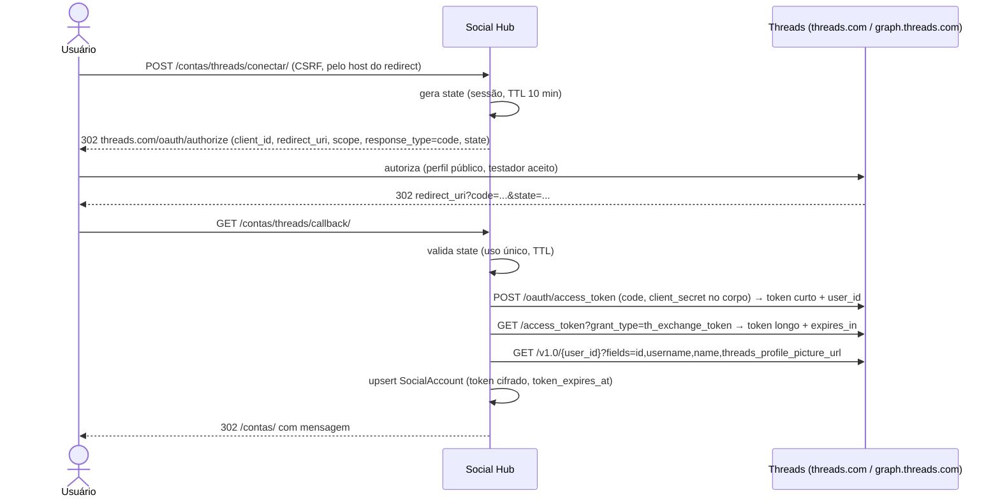

# Technical Design Doc — Threads: conectar perfil e publicar texto

> **Tier:** arquitetural · **Status:** aprovado
> **Autor:** Thalyson · **Revisores:** — · **Data:** 2026-11-17
> Responde: **como** no nível de sistema. O porquê está em [`product.md`](./product.md).
> Detalhes da API verificados na documentação oficial da Meta (Threads API) em 2026-11-17.

## Links e artefatos

| Artefato                 | Onde                | Link                                                                 |
|--------------------------|---------------------|----------------------------------------------------------------------|
| Docs Threads API         | Meta for Developers | https://developers.facebook.com/docs/threads/overview                |
| Tokens (curto/longo)     | Meta for Developers | https://developers.facebook.com/docs/threads/get-started/long-lived-tokens/ |
| Publicação de posts      | Meta for Developers | https://developers.facebook.com/docs/threads/posts/                  |
| Spec · Product · Domínio | repositório         | `./spec.md` · `./product.md` · `./domain.md`                         |
| Features base            | repositório         | [0002](../0002-facebook-page-connect/spec.md) · [0003](../0003-publicar-no-facebook/spec.md) |

## Contexto da funcionalidade
A 0002 conecta Páginas (token que não expira) e a 0003 publica texto + imagem nelas, com claim atômico por alvo, lotes e retry.
O Threads é uma **API separada**: login em `threads.com`, host `graph.threads.com`, credenciais próprias (`THREADS_APP_ID`/`SECRET`)
e **tokens que expiram em 60 dias**. O app Meta já tem o caso de uso, o túnel HTTPS de desenvolvimento e o redirect cadastrado.
Restrição herdada: Gunicorn síncrono (`--timeout 180`), sem fila/worker.

## Goals / Non-goals
**Goals**
- Conectar um perfil do Threads (OAuth com `state`), guardando o token de longa duração **cifrado** e sua **expiração**.
- Renovar o token **sob demanda** (publicar / verificar); expirado → `needs_reauth`.
- Publicar **texto (≤ 500)** no Threads pelo formulário da 0003, com **alvos mistos** (Páginas + perfis), reutilizando claim, lotes, retry e histórico.
- Evoluir o modelo e o serviço de publicação para **publicador por plataforma**, sem quebrar o Facebook.

**Non-goals**
- Imagem/vídeo/carrossel, respostas, insights, menções, Instagram, agendamento, renovação em segundo plano, perfis privados, callbacks de desinstalação/exclusão.

## Glossário (da funcionalidade)

| Termo                | Descrição                                                                                           |
|----------------------|-----------------------------------------------------------------------------------------------------|
| Perfil do Threads    | Conta do Threads conectada; vira uma `SocialAccount` com `platform=threads`.                         |
| Token de longa duração | Token do Threads válido por 60 dias; renovável (`th_refresh_token`) depois de 24 h de vida.        |
| Renovar              | Trocar o token vigente por um novo de 60 dias, sem o usuário fazer login.                            |
| Container (Threads)  | Objeto intermediário criado antes de publicar; tem `status` (IN_PROGRESS, FINISHED, ERROR, EXPIRED, PUBLISHED). |
| Peso do texto        | Contagem usada para validar os 500 do Threads (emoji conta por bytes UTF-8).                         |
| Alvo misto           | Publicação cujos destinos incluem Páginas do Facebook **e** perfis do Threads.                       |

## Design proposto

### Conexão (OAuth do Threads)



- **Sem tela de seleção:** o login devolve um único perfil.
- O sufixo `#_` que o Threads acrescenta ao `code` fica no *fragmento* da URL e **nunca chega ao servidor**; nada a tratar.
- **Host do redirect:** o cookie de sessão é por host. A conexão deve ser iniciada pelo **mesmo host** do `THREADS_REDIRECT_URI`
  (o túnel em dev). Se o usuário clicar em `localhost`, o Hub avisa "Acesse por {host} para conectar o Threads" em vez de falhar no `state`.
- Cancelamento: o Threads redireciona com `error=access_denied` → mensagem amigável, nada criado.

### Renovação do token (sob demanda)
`ensure_fresh(account)` (em `services/threads_tokens.py`):
1. `token_expires_at <= agora` → `needs_reauth` (sem chamada).
2. faltam **< `THREADS_REFRESH_WINDOW_DAYS`** (padrão 30) **e** o token tem **≥ 24 h** (`token_refreshed_at`) → `GET /refresh_access_token?grant_type=th_refresh_token`
   → novo token e nova expiração (60 dias a partir de agora).
3. caso contrário, não faz nada.
Chamada **antes de publicar** em um alvo Threads e no **Verificar**. *Contas conectadas* só **sinaliza** a validade (cálculo local,
sem rede); se o token já passou da expiração, a conta aparece como "Reconexão necessária". (Isto refina o texto do `product.md`.)

### Publicar texto no Threads
Por alvo (dentro do claim e do lote da 0003):
1. `ensure_fresh(account)`.
2. Se o alvo já tem `external_container_id` e o container não expirou (< 24 h): reutiliza; senão
   `POST /v1.0/{user_id}/threads` com `media_type=TEXT`, `text` (corpo do POST) → `id` do container, **gravado no alvo** antes de seguir.
3. **Aguarda o container**: `GET /v1.0/{container_id}?fields=status,error_message`, a cada ~2 s, até `THREADS_CONTAINER_WAIT_SECONDS` (padrão 20 s).
   `FINISHED` → segue; `ERROR`/`EXPIRED` → falha; esgotou o tempo → falha **reenviável** ("O Threads ainda está processando. Tente novamente."),
   mantendo o container para retomar. `PUBLISHED` → marca como publicado (sem link) e **não** republica.
4. `POST /v1.0/{user_id}/threads_publish` com `creation_id` → id da mídia.
5. `GET /v1.0/{media_id}?fields=permalink` (melhor esforço; sem link se falhar) → `permalink`.
A recomendação da Meta de "esperar ~30 s" é tratada com o **endpoint de status** em vez de espera fixa.

### Publicador por plataforma (refatoração mínima)
`publishing._publish_target` passa a despachar por `account.platform`:
- `facebook_page` → fluxo atual (`publish_photo`).
- `threads` → novo `ThreadsPublisher` (acima).
O claim atômico, o lote (`PUBLISH_BATCH_SIZE`), o retry, o `needs_reauth` e o mapeamento de erros continuam **comuns**.

### Formulário misto e regras
- A lista de destinos agrupa **Páginas do Facebook** e **perfis do Threads** ativos (ícone/rótulo da plataforma).
- **Imagem obrigatória só se houver Página do Facebook marcada**; só-Threads → imagem opcional e **ignorada** (não é gravada; aviso na tela).
- **Texto:** até 5000; se houver Threads marcado, até **500 de "peso"** e **no máximo 5 links** únicos.
- **Peso do texto:** `len(texto)` com cada caractere fora do BMP (emoji) contado como **4** (bytes UTF-8) — validação **conservadora**; a Meta tem a palavra final.
- Validação da imagem passa a ocorrer em `Form.clean()` (depende dos destinos), reaproveitando `sanitize_image`.
- `Publication.image` e `image_content_type` ficam **opcionais** (publicação só-Threads). A view da imagem responde 404 sem imagem; templates mostram um ícone no lugar.

### Modelo de dados (migração sobre a 0002/0003)

`SocialAccount` (+): `Platform.THREADS = "threads"`; `username` (CharField, blank); `token_expires_at` (DateTime, nulo);
`token_refreshed_at` (DateTime, nulo). Para o Facebook os campos de token ficam nulos (Páginas não expiram).
`PublicationTarget` (+): `external_container_id` (CharField, blank) e `platform` (snapshot da plataforma do destino, padrão `facebook_page`, para o histórico e o despacho sobreviverem à desconexão da conta).
`Publication` (±): `image` e `image_content_type` passam a `blank=True`.

### Componentes

```
apps/social/
  services/meta.py            + BaseGraphClient (host, versão, _request sanitizado) usada por GraphClient e ThreadsClient
  services/threads.py         ThreadsClient: login_url, exchange_code, extend_token, refresh_token, get_profile,
                              create_text_container, container_status, publish_container, get_permalink
  services/threads_connect.py connect_profile(user, code) → upsert; state (reutiliza as funções de state da 0002)
  services/threads_tokens.py  ensure_fresh(account)
  services/threads_publish.py ThreadsPublisher.publish(target) (container → espera → publica → permalink)
  textrules.py                threads_weight(text), count_unique_links(text)
  models.py · forms.py · views.py · views_publications.py (ajustes)
templates/social/accounts.html (+ Threads), post_form.html (destinos mistos), post_detail.html/posts.html (sem imagem)
```

### Rotas novas

| Rota                           | Método | Nome                      | Função                                          |
|--------------------------------|--------|---------------------------|-------------------------------------------------|
| `/contas/threads/conectar/`    | POST   | `social:threads_connect`  | Inicia o OAuth (valida o host do redirect)      |
| `/contas/threads/callback/`    | GET    | `social:threads_callback` | Recebe o code e conecta o perfil                |

`/contas/<id>/verificar/` e `/desconectar/` passam a atender também contas Threads (verificar = renovar se devido + `GET` do perfil).

### Chamadas e segredos (AC-16 da 0002 continua valendo)
- **Documentado pela Meta:** `client_secret` + `code` em **POST (corpo)**; `th_exchange_token` e `th_refresh_token` são **GET** com
  `client_secret`/`access_token` na **query**; perfil, status do container e permalink são **GET com `access_token` na query**;
  criar container e publicar são **POST com `access_token` no corpo**. Não está documentado o uso de `Authorization: Bearer`.
- **Salvaguardas (mantidas):** URLs, parâmetros e corpos de resposta **nunca** são logados nem exibidos; exceções são sanitizadas;
  `urllib3` em WARNING; tokens e `client_secret` jamais em HTML/mensagens. No UAT testamos **POST** nas trocas e **Bearer** nos GETs; se a Meta aceitar,
  passamos a usá-los (não é preciso mudar a spec).

### Configuração

| Variável                            | Padrão              | Descrição                                                         |
|-------------------------------------|---------------------|-------------------------------------------------------------------|
| `THREADS_APP_ID` / `THREADS_APP_SECRET` | —               | Credenciais do caso de uso Threads (**diferentes** das do app principal) |
| `THREADS_REDIRECT_URI`              | —                   | **HTTPS**; idêntica à cadastrada na Meta (túnel em dev)           |
| `THREADS_GRAPH_VERSION`             | `v1.0`              | Versão no caminho da API                                          |
| `THREADS_REFRESH_WINDOW_DAYS`       | `30`                | Renova quando faltar menos que isso                               |
| `THREADS_CONTAINER_WAIT_SECONDS`    | `20`                | Tempo máximo esperando o container ficar `FINISHED`               |

Sem as variáveis `THREADS_*`, o Threads fica desabilitado (botão desabilitado) e o resto do sistema não é afetado.

## Cobertura dos 5 eixos

### 1. Tech stack
Sem dependências novas (`requests`, Fernet, Pillow já existem). Novo host `graph.threads.com` e `threads.com` (login).

### 2. Arquitetura base
Mesmo contexto **Social**. Novo cliente (ACL) `ThreadsClient`, irmão do `GraphClient`, sobre uma base comum. O despacho por plataforma
no serviço de publicação prepara Instagram e futuros destinos. O token **com expiração** é um conceito novo no agregado `SocialAccount`.

### 3. Infra
Nada novo no Docker. **Produção:** domínio com **HTTPS** obrigatório para o `THREADS_REDIRECT_URI`. **Desenvolvimento:** túnel HTTPS
(URL muda; atualizar Meta + `.env`). **Reversão:** remover `THREADS_*` desliga o Threads; as migrações são reversíveis.

### 4. Qualidade
Cliente mockado no transporte HTTP (como 0002/0003); um teste por AC. Casos: `state`, cancelamento, falhas da Meta, expiração/renovação
(relógio controlado), container (`FINISHED`/`ERROR`/timeout/`PUBLISHED`/reuso), formulário misto (matriz de regras), peso do texto (emoji), limite de links,
isolamento entre usuários, segredos fora de HTML/logs, não-regressão da 0003 (suíte existente verde).

### 5. Observabilidade
Logger `apps.social.meta`: `threads_oauth_started`, `threads_connected`, `threads_token_refreshed`, `threads_token_expired`,
`threads_container_created`, `threads_container_wait ms=…`, `publish_ok/failed platform=threads`. Sem tokens, URLs nem texto.

## Mapa de dependências

| Dependência             | Tipo        | Descrição                              | Endpoints                                                              |
|-------------------------|-------------|----------------------------------------|------------------------------------------------------------------------|
| Threads OAuth           | OAuth 2.0   | Autorização do usuário                 | `GET https://threads.com/oauth/authorize`                              |
| Threads Graph API       | REST        | Tokens, perfil, publicação, status     | `POST /oauth/access_token` · `GET /access_token` · `GET /refresh_access_token` · `GET /v1.0/{id}` · `POST /v1.0/{id}/threads` · `GET /v1.0/{container}` · `POST /v1.0/{id}/threads_publish` |
| `SocialAccount` (0002)  | modelo      | Conta, token cifrado, status           | + expiração do token                                                   |
| Serviço de publicação (0003) | serviço | Claim, lotes, retry, erros             | despacho por plataforma                                                |

## Solução

| #  | Bloco                                   | Descrição                                                                 | Status     |
|----|-----------------------------------------|---------------------------------------------------------------------------|------------|
| 1  | Settings, `.env.example`, `textrules`   | `THREADS_*`, peso do texto, contagem de links                             | definido   |
| 2  | Modelo + migração                       | `threads`, `username`, expiração, `external_container_id`, imagem opcional| definido   |
| 3  | `BaseGraphClient` + `ThreadsClient`     | Chamadas conforme a doc, erros sanitizados                                | definido   |
| 4  | Conexão (state, callback, upsert)       | Fluxo OAuth + aviso de host                                               | definido   |
| 5  | Renovação sob demanda                   | `ensure_fresh`                                                            | definido   |
| 6  | `ThreadsPublisher` + despacho           | Container → espera → publica → permalink                                  | definido   |
| 7  | Formulário misto e telas                | Regras por destino; contas/lista/detalhe sem imagem                       | definido   |
| 8  | Dashboard                               | Threads "Conectado"                                                       | definido   |
| 9  | POST nas trocas e Bearer nos GETs       | Mais seguro, se a Meta aceitar                                            | indefinido |

## Alternativas consideradas

| Alternativa                                                  | Prós                                              | Contras                                                  | Decisão |
|--------------------------------------------------------------|---------------------------------------------------|----------------------------------------------------------|---------|
| **A. Cliente Threads próprio sobre base comum**              | Host/params diferentes isolados; reuso de erros   | Mais um cliente                                          | **Escolhida** |
| B. Reusar `GraphClient` com flags                            | Menos arquivos                                    | Mistura dois protocolos; frágil                          | Não     |
| **C. Renovação sob demanda**                                 | Sem worker                                        | Token ocioso > 60 dias expira (reconexão)                | **Escolhida** |
| D. Renovar em segundo plano                                  | Não expira por inatividade                        | Exige fila/cron                                          | Futuro  |
| **E. Status do container em vez de esperar 30 s fixos**      | Rápido quando já está pronto; segue a doc         | Polling dentro da requisição                             | **Escolhida** |
| F. Esperar 30 s fixos                                        | Simples                                           | Lento; estoura o lote                                    | Não     |
| **G. Despacho por plataforma no serviço de publicação**      | Prepara Instagram; mantém claim/lote/retry comuns | Refatoração do `_publish_target`                         | **Escolhida** |
| H. Fluxo/serviço separados para o Threads                    | Não toca no Facebook                              | Duplica claim/lote/retry; sem alvo misto                 | Não     |
| **I. Validar imagem em `Form.clean()` conforme os destinos** | Regra condicional correta                         | Reorganiza a validação atual                             | **Escolhida** |
| **J. Peso conservador (emoji = 4)**                          | Evita erro da Meta                                | Pode recusar texto que a Meta aceitaria                  | **Escolhida** |

## Trade-offs e consequências
- **Ganhamos:** Threads no mesmo fluxo e histórico, base pronta para Instagram, sem infra nova.
- **Aceitamos:** token pode expirar por inatividade; tokens em query nos GETs documentados (mitigado por não logar); validação de texto conservadora;
  espera dentro da requisição; alvos Threads sempre sem imagem.
- **Dívida:** sem renovação em segundo plano; sem callbacks de desinstalação/exclusão (necessários para o modo Live); a janela de duplicidade (#1) ainda
  existe no Facebook (no Threads o `external_container_id` reduz o risco).

## Riscos

| Risco                          | Descrição                                                        | Prob. × Impacto | Ações / mitigações                                                             |
|--------------------------------|------------------------------------------------------------------|-----------------|--------------------------------------------------------------------------------|
| Token expira por inatividade   | Sem uso por > 60 dias                                            | média × baixa   | `needs_reauth` claro e botão Reconectar                                        |
| Segredo/token em URL           | GETs documentados pedem `access_token` na query                  | média × média   | Nunca logar URL/params; exceções sanitizadas; testar POST/Bearer no UAT        |
| Redirect/host divergente       | Túnel muda; `localhost` ≠ host do redirect                       | alta × baixa    | Aviso de host; `.env` e Meta atualizados quando o túnel mudar                  |
| Contagem de 500 diverge        | Emoji por bytes, links                                           | média × baixa   | Peso conservador; erro da Meta tratado                                         |
| Container lento                | `IN_PROGRESS` acima do orçamento                                 | média × baixa   | Falha reenviável com retomada pelo `external_container_id`                     |
| Códigos de erro não documentados | Token inválido/limite sem código publicado                     | média × média   | Mapeamento genérico + HTTP 429/190; ajustar após UAT                           |
| Perfil privado / testador      | Não autoriza ou convite não aceito                               | média × baixa   | Mensagens claras; documentar no README                                         |
| Regressão na 0003              | Mudança de imagem opcional e despacho                            | baixa × alta    | Suíte existente verde + testes de não-regressão                                |

## Roadmap da feature

| Fase / onda | Entrega                                                       | Quando       | Depende de |
|-------------|---------------------------------------------------------------|--------------|------------|
| 1 (MVP)     | Conectar Threads + publicar texto em alvos mistos             | esta feature | 0002, 0003 |
| 2           | Imagem no Threads (URL pública assinada) e Instagram          | depois       | 1          |
| 3           | Renovação em segundo plano e callbacks de desinstalação/exclusão (Live) | depois | fila/worker |

## Questões em aberto
- [ ] **POST e Bearer:** testar no UAT se a Meta aceita `th_exchange_token`/`th_refresh_token` por POST e `Authorization: Bearer` nos GETs.
- [ ] **Tempo do container de texto:** confirmar no UAT se fica `FINISHED` rápido ou exige a espera de ~30 s.
- [ ] **Códigos de erro** de token inválido e de limite no Threads (não documentados): confirmar nos primeiros erros reais.
- [ ] **Host `graph.threads.com` × `.net`:** usamos `.com` (nos exemplos da doc); a doc diz que ambos funcionam.
- [ ] **Redirect HTTPS em produção:** exige domínio com TLS.

> Decisões difíceis de reverter → ADRs ao aprovar este design:
> **ADR-0006** Threads: cliente próprio, token de 60 dias com expiração e renovação sob demanda ·
> **ADR-0007** Publicação por plataforma: despacho por alvo e formulário misto (imagem condicional).
