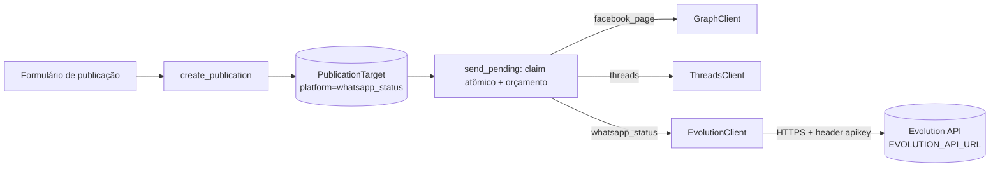

# Technical Design Doc — WhatsApp: publicar no Status via Evolution API

> **Tier:** arquitetural · **Status:** rascunho
> **Autor:** Claude · **Revisores:** Thalyson · **Data:** 2026-11-17
> Responde: **como** no nível de sistema. Parte do [`product.md`](./product.md).

## Links e artefatos
| Artefato                 | Onde        | Link                                                         |
|--------------------------|-------------|--------------------------------------------------------------|
| Spec · Product · Domínio | repositório | `./spec.md` · `./product.md` · `./domain.md`                 |
| Base                     | repositório | [0004](../0004-threads-conectar-e-publicar/design.md) · [0005](../0005-threads-imagem/design.md) · [ADR-0007](../../docs/architecture/adr/0007-publicacao-por-plataforma-despacho-por-alvo-e-formulario-misto.md) · [ADR-0009](../../docs/architecture/adr/0009-orcamento-de-tempo-por-requisicao-de-publicacao.md) |
| ADR desta feature        | repositório | [ADR-0010](../../docs/architecture/adr/0010-whatsapp-status-via-evolution-api-instancia-chave-cifrada-e-host-fixo.md) |

## Contexto da funcionalidade
O Hub publica por **plataforma** (despacho por alvo, ADR-0007): Facebook (Graph) e Threads (cliente próprio). O operador tem uma **Evolution API**
(Baileys) com o número já pareado e quer o **Status do WhatsApp** como mais um destino no mesmo formulário.
Diferenças em relação às plataformas atuais: **não há OAuth nem conexão interativa** (a "conta" é uma instância já pareada, acessada por chave),
o envio é **uma chamada só** (sem container/espera), a mídia pode ir **em base64** (sem URL pública) e **não existe link** do post publicado.

## Goals / Non-goals
**Goals**
- Nova plataforma `whatsapp_status` reaproveitando `SocialAccount`, `PublicationTarget`, claim atômico, orçamento de tempo e mensagens amigáveis.
- Cadastro de instância por formulário (nome + chave), validando a conexão (`open`) antes de gravar; chave cifrada (ADR-0002).
- Envio de Status de texto e de imagem (base64) para **todos os contatos**.
- Nenhum segredo (chave, base64, texto) em log, HTML, mensagem de erro ou histórico.

**Non-goals**
- QR/pareamento, criação de instâncias, grupos/contatos/canais, lista de JIDs, vídeo/áudio, cor/fonte, webhooks, Cloud API, fila, agendamento, apagar Status.

## Glossário (da funcionalidade)
| Termo | Descrição |
|---|---|
| **Instância (Evolution)** | Sessão de um número de WhatsApp pareado na Evolution; identificada por um nome; acessada por uma chave própria. |
| **Status do WhatsApp** | Publicação efêmera (≈ 24 h) do WhatsApp, vista pelos contatos do número. Único destino desta feature. |
| **Conta de WhatsApp** | `SocialAccount` com `platform=whatsapp_status`: `external_id` = nome da instância, token cifrado = chave da instância. |

## Design proposto

**Modelo de dados** (uma migração, só `choices`): `SocialAccount.Platform.WHATSAPP_STATUS = "whatsapp_status"`. Reuso dos campos:
`external_id` = nome da instância (validado `^[A-Za-z0-9_-]{1,64}$`), `name` = rótulo livre ou o nome da instância, `access_token_enc` = chave da instância (Fernet),
`token_expires_at` nulo (a chave não expira). `PublicationTarget.external_post_id` = id da mensagem retornado (se houver); `permalink` vazio ("link indisponível" já existe).

**Cliente** `apps/social/services/evolution.py` — `EvolutionClient.from_settings()` no mesmo padrão do `ThreadsClient` (transporte único, mockável):
- URL base **só** de `EVOLUTION_API_URL` (HTTPS obrigatório; usuário nunca informa host → sem SSRF); nome da instância codificado na rota; header `apikey: <chave da instância>`.
- `connection_state(instance, key)` e `send_status(instance, key, ...)`; timeout curto de conexão e leitura limitada pelo orçamento restante.
- Erros → `EvolutionApiError(status, code)`; texto cru da Evolution **nunca** vai ao usuário.

**Contrato do endpoint — NÃO CONFIRMADO.** A documentação oficial não pôde ser lida nesta sessão (páginas 404/410). O que se sabe por pesquisa (fontes secundárias, a validar):
`POST /message/sendStatus/{instância}` com corpo `{type: text|image, content, caption?, backgroundColor?, font?, allContacts, statusJidList?}`;
há relato de versões que usam um objeto `statusMessage` embrulhando esses campos; formato do número/JID e do base64 (com ou sem prefixo `data:`) divergem entre fontes.
**Decisão:** o cliente isola o formato num único ponto; a spec descreve o comportamento (não o corpo), e a task de UAT **fixa o contrato lendo a sua instância** (versão em `GET /` do manager) antes de marcar `done`.

**Fluxo de envio** (`evolution_publish.py`, chamado por `_publish_evolution_target`): descriptografa chave → (se imagem) lê o arquivo sanitizado e codifica base64 →
`send_status(... allContacts=true)` → grava `published` com o id → log sem conteúdo. Sem container, sem espera, sem retomada.

**Cadastro** (`views_evolution.py`, `/contas/whatsapp/`): formulário nome-da-instância + chave (+ rótulo); chama `connection_state`; só grava se `open`; mesma conta reenviada atualiza a chave
(idempotente, constraint existente). Desconectar remove a conta (histórico preservado, como hoje).

**Formulário de publicação:** novo grupo "Status do WhatsApp" (contas ativas; em reauth desabilitadas). Regras: imagem **opcional** com WhatsApp (obrigatória só com Página do Facebook, como já é);
com imagem, vale a sanitização existente. O limite de texto do Status **não está documentado** → não validar além do vazio (ver Questões em aberto).

**Estado da conexão:** falha de autenticação (401/403) ou estado ≠ `open` → conta `needs_reauth` e alvo `failed` com "Reconecte o número na Evolution"; outras falhas → `failed` reenviável.

## Cobertura dos 5 eixos
### 1. Tech stack
Sem lib nova: `requests`/transporte já usados pelo `ThreadsClient`, `base64` da stdlib. Novas settings `EVOLUTION_API_URL`, `EVOLUTION_TIMEOUT_SECONDS` (`.env.example` documenta).
### 2. Arquitetura base
Mesmo bounded context `social`, nova plataforma e novo cliente (porta/adaptador como Facebook/Threads); `interfaces → application → domain ← infrastructure` preservado
(`evolution.py` é infraestrutura; regras de mensagem/estado em `publishing`). Sem mudança no context-map além de registrar a Evolution como sistema externo.
### 3. Infra
Sem recurso novo. Depende de a Evolution ser alcançável por HTTPS a partir do container do Hub. **Reversão:** remover a plataforma do formulário e/ou apagar as contas; nenhum dado de outras plataformas é afetado.
### 4. Qualidade
Um teste por AC; Evolution **sempre mockada no transporte**; relógio injetado para o orçamento; testes de segurança (chave/base64/texto fora de logs e HTML; host só do servidor; instância inválida rejeitada).
UAT real em grupo/número de teste (Status não é apagável pelo Hub).
### 5. Observabilidade
Logs `evolution_status_sent`, `evolution_state` e `publish_failed code=...` com **apenas** ids de alvo e códigos; nunca chave, base64 ou texto. Métrica de prova: `publish_batch ok=/failed=` já existente.

## Mapa de dependências
| Dependência | Tipo | Descrição | Principais endpoints (a confirmar) |
|---|---|---|---|
| Evolution API (instância do operador) | REST/HTTPS | Envia o Status pelo número pareado (Baileys) | `POST /message/sendStatus/{instância}` · `GET /instance/connectionState/{instância}` |
| Fernet (ADR-0002) | biblioteca | Cifra a chave da instância | `encrypt_token` / `decrypt_token` |
| Pillow/`images.py` (ADR-0005) | biblioteca | Imagem já sanitizada (JPEG/PNG ≤ 8 MB) | `SanitizedImage` |

## Solução
| # | Bloco | Descrição | Status |
|---|---|---|---|
| 1 | Config + plataforma | settings, `.env.example`, `Platform.WHATSAPP_STATUS`, migração, `conf.evolution_configured()` | definido |
| 2 | `EvolutionClient` | `connection_state`, `send_status`, erros, timeouts | definido (corpo a confirmar) |
| 3 | Cadastro de instância | tela, validação do nome, verificação `open`, chave cifrada, desconectar | definido |
| 4 | Formulário | grupo WhatsApp, imagem opcional, mensagens | definido |
| 5 | Publicador + despacho | `evolution_publish`, mensagens amigáveis, reauth, orçamento | definido |
| 6 | Segurança transversal | sem segredos em logs/HTML, host fixo, instância validada | definido |
| 7 | Contrato real + UAT | fixar formato do corpo/base64/JID na sua instância e publicar em número de teste | **indefinido** (depende da doc/instância) |

## Alternativas consideradas
| Alternativa | Prós | Contras | Por que (não) escolhida |
|---|---|---|---|
| **A: plataforma nova reusando `SocialAccount` (escolhida)** | mínimo de código novo; histórico, idempotência e orçamento já prontos | `external_id`/token com semântica adaptada | encaixa no despacho por alvo (ADR-0007) sem nova tabela |
| B: modelo `EvolutionInstance` separado | semântica limpa | novo agregado, duplica contas/seleção/reauth no formulário | custo alto para um único tipo de destino |
| C: URL + chave globais no `.env` | zero tela | uma instância só; usaria poder total da Evolution | decisão do operador: chave por instância cifrada |
| D: imagem por URL pública (0005) | reaproveita rota | exige túnel/domínio; imagem sai na internet | decisão do operador: base64 |

## Trade-offs e consequências
Ganha-se velocidade e consistência; aceita-se `external_id`/token com semântica por plataforma (documentada no glossário) e a **ausência de link** no histórico.
Dívida assumida: sem idempotência forte em timeout após envio (mesma janela da [issue #1](https://github.com/thalisonwilker/social-hub/issues/1)) — o alvo falha e um reenvio pode duplicar o Status.

## Riscos
| Risco | Descrição | Prob. × Impacto | Ações / mitigações |
|---|---|---|---|
| Banimento do número | Baileys não é oficial | baixo × alto | uso manual e esporádico; documentar; sem envio em massa |
| Contrato divergente | Corpo/formato varia por versão; doc inacessível | alto × médio | isolar no cliente; fixar no UAT; mocks refletem o contrato confirmado |
| Vazamento da chave | Chave envia mensagens pelo número | baixo × alto | Fernet; nunca em log/HTML; formulário sem eco; chave de instância, não a global |
| SSRF | Host controlado pelo usuário | baixo × alto | host só do `.env` (HTTPS); nome da instância validado e codificado |
| Tempo | base64 (+33%) + rede lenta | médio × médio | timeout limitado pelo orçamento restante (ADR-0009); falha reenviável |
| Duplicidade | Timeout após o envio | médio × baixo | documentado; issue #1 |

## Roadmap da feature
| Fase | Entrega | Depende de |
|---|---|---|
| 1 (MVP) | Status de texto e imagem, cadastro de instância, formulário misto | contrato confirmado no UAT |
| 2 | Lista de contatos, grupos/canais, vídeo | 1 |

## Questões em aberto
- [ ] **Contrato do endpoint** (corpo plano × `statusMessage`; base64 com/sem `data:`; resposta): confirmar na sua instância/versão (task 7).
- [ ] **Limite de texto** do Status e peso da legenda da imagem: não documentado → não validar até o UAT.
- [ ] **Estado da conexão:** endpoint e valores de `state` a confirmar (`open`/`close`/`connecting`).
- [x] ADR-0010 (credenciais por instância + host fixo + Baileys) — escrito na T9.
