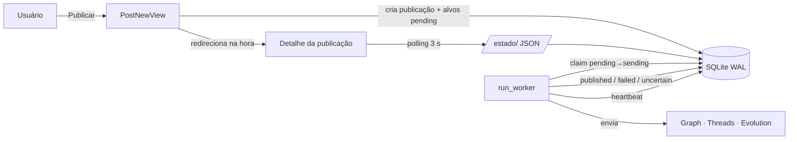
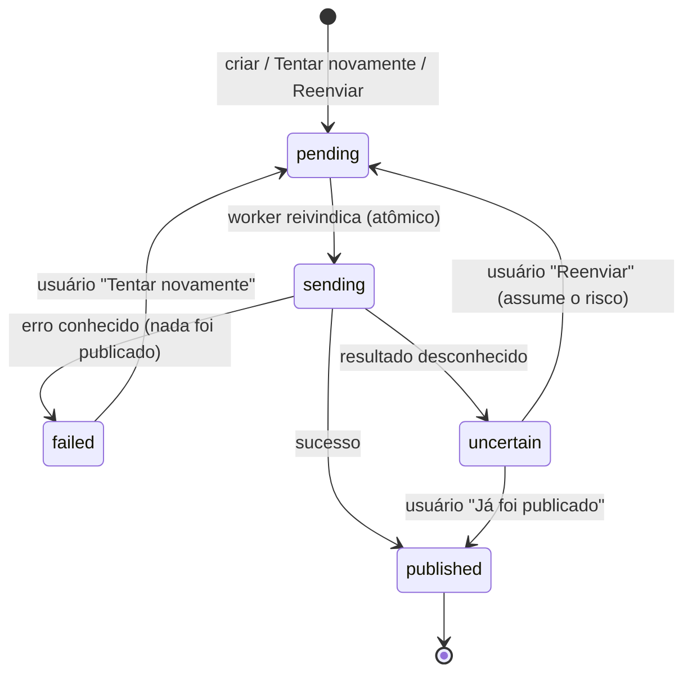

# Technical Design Doc — Publicação em segundo plano

> **Tier:** arquitetural · **Status:** rascunho
> **Autor:** Claude · **Revisores:** Thalyson · **Data:** 2026-11-17
> Responde: **como** no nível de sistema. Parte do [`product.md`](./product.md).

## Links e artefatos
| Artefato                 | Onde        | Link |
|--------------------------|-------------|------|
| Spec · Product · Domínio | repositório | `./spec.md` · `./product.md` · `./domain.md` |
| Base                     | repositório | [ADR-0004](../../docs/architecture/adr/0004-publicacao-sincrona-em-lotes-idempotente.md) · [ADR-0007](../../docs/architecture/adr/0007-publicacao-por-plataforma-despacho-por-alvo-e-formulario-misto.md) · [ADR-0009](../../docs/architecture/adr/0009-orcamento-de-tempo-por-requisicao-de-publicacao.md) · [0006](../0006-whatsapp-status/design.md) |
| ADR desta feature        | repositório | ADR-0011 (a escrever com a spec) |
| Issues                   | GitHub      | [#1](https://github.com/thalisonwilker/social-hub/issues/1) · [#4](https://github.com/thalisonwilker/social-hub/issues/4) |

## Contexto da funcionalidade
O envio acontece **dentro** da requisição HTTP (`send_pending`): claim atômico por alvo, orçamento de 150 s (ADR-0009), recuperação de `sending` preso após 5 min (ADR-0004).
Isso gera duplicidade quando o resultado é desconhecido (UAT do WhatsApp; issue #1), exige "Continuar envio" (issue #4) e impede agendar.
O banco é **SQLite em WAL** (`timeout=20`, `transaction_mode=IMMEDIATE`), uma instância do Hub, Gunicorn com 2 workers, `docker compose` com um serviço `web`.

## Goals / Non-goals
**Goals**
- Publicar **enfileira** (alvos `pending`) e responde em < 2 s; um **worker** envia fora da requisição.
- Alvo com resultado **desconhecido** vira `uncertain` e **nunca** volta sozinho para a fila.
- Progresso na tela por polling; aviso quando não há worker; operação simples (um comando, um container).
- Modo **inline** (envio na requisição, como hoje) como padrão de **dev/testes**, para não reescrever ~500 testes e para rodar sem worker.

**Non-goals**
- Agendamento, Celery/Redis, vários workers/instâncias, SSE/WebSocket, consultar a plataforma, backoff automático, cancelar envio.

## Glossário (da funcionalidade)
| Termo | Descrição |
|---|---|
| **Fila** | Os próprios alvos `pending` no banco (FIFO por id). Sem tabela de jobs. |
| **Worker** | Processo `manage.py run_worker` que reivindica um alvo `pending` por vez e o envia. |
| **Alvo Incerto** (`uncertain`) | Alvo cujo envio pode ter sido concluído pela plataforma, mas o Hub não sabe. Só o usuário o resolve. |
| **Heartbeat do worker** | Linha única `WorkerHeartbeat` atualizada pelo worker; mostra se há worker ativo. |
| **Modo de publicação** | `PUBLISH_MODE`: `worker` (produção) ou `inline` (dev/testes). |

## Design proposto

### Estados do alvo

O worker só reivindica `pending`. **Não existe mais recuperação automática de `sending`** (a causa da issue #1): `sending` só sai por `published`, `failed` ou `uncertain`.

### Quando o resultado é incerto
Incerto = a chamada **com efeito** (a que cria o post) foi **enviada** e a resposta não chegou, ou o worker morreu durante ela.

| Plataforma | Chamada com efeito | Vira `uncertain` quando | Continua `failed` quando |
|---|---|---|---|
| Facebook (Graph) | `POST /{page}/photos` | tempo esgotado de leitura / conexão cortada depois de enviar | recusa da Meta, token, conexão nunca estabelecida |
| Threads | `POST /{user}/threads_publish` (container já pronto) | idem | criação/espera do container (nada publicado), recusa |
| WhatsApp (Evolution) | `POST /message/sendStatus` | `timeout` de leitura / conexão cortada | recusa (4xx), 5xx com corpo, instância fora, conexão nunca estabelecida |
| Qualquer | — | **worker reiniciado** com o alvo `sending`, ou `sending` além de `PUBLISH_SENDING_STALE_SECONDS` | — |

Os clientes passam a **distinguir** "nunca chegou ao servidor" (DNS, recusada, TLS → `network`, certo) de "enviei e a resposta não veio" (`interrupted`/`timeout`, incerto).

### Worker (`run_worker`)
Laço único e síncrono (um alvo por vez, FIFO):
1. **Na partida:** todo alvo `sending` vira `uncertain` (`worker_restart`) — com um único worker, nenhum deles tem dono vivo.
2. Atualiza o *heartbeat*; reivindica o próximo `pending` (`UPDATE … WHERE status='pending'`, atômico); se não há, dorme `WORKER_POLL_SECONDS` (2 s).
3. Envia com o mesmo despacho por plataforma de hoje (`_publish_target`, `_publish_threads_target`, `_publish_whatsapp_target`), **sem orçamento por requisição**: usa o timeout de cada chamada (Evolution 120 s, Threads `THREADS_IMAGE_WAIT_SECONDS`, Graph upload).
4. Grava o resultado; a cada ciclo reaparece o *reaper* (`sending` além de `PUBLISH_SENDING_STALE_SECONDS`=900 → `uncertain`, `stale`).
5. **SIGTERM:** termina o alvo atual e sai (`stop_grace_period` do compose cobre o maior envio); morte forçada cai na regra da partida.

Escolha de **não** usar thread de heartbeat: o *heartbeat* é gravado entre alvos e a tela considera o worker parado após `WORKER_HEARTBEAT_STALE_SECONDS`=180 s (maior que a chamada mais longa).

### Modelo de dados (uma migração)
- `PublicationTarget.Status.UNCERTAIN = "uncertain"` ("Incerto"); `error_code` ∈ `timeout | interrupted | worker_restart | stale`; `error_message` guarda a explicação amigável.
- `Publication.status` derivado: `failed` > `uncertain` > `published` (todos) > `pending`. Novo rótulo geral **"Incerta"**.
- `WorkerHeartbeat(name unique, started_at, beat_at, pid)` — uma linha (`name="default"`).
- `PublicationTarget.is_retryable` só vale para `failed`; novo `is_resolvable` para `uncertain` (com conta ou sem: "Já foi publicado" funciona sem conta; "Reenviar" exige conta).

### Requisições e telas
- **`PostNewView`:** em `worker`, cria e redireciona com "Publicação enfileirada…"; em `inline`, comporta-se como hoje.
- **`PostSendView`** ("Tentar novamente"): `failed → pending` (atômico) e, em `inline`, envia na hora. O botão "Continuar envio" **sai**.
- **Novo** `POST /publicacoes/<pk>/alvos/<id>/resolver/` com `acao=publicado|reenviar` só para alvos `uncertain` do dono (confirmação no cliente; CSRF).
- **Novo** `GET /publicacoes/<pk>/estado/` (JSON, só o dono): `{status, counts, targets:[{id,status}], worker:{active}, done}`. O detalhe consulta a cada 3 s enquanto `done=false` e **recarrega a página quando algo muda**; para quando `done=true`.
- **Aviso** no detalhe quando há `pending/sending` e o worker não está ativo.
- Mensagens novas amigáveis; nada de segredo/conteúdo em log.

### Infra
- `docker-compose.yml`: serviço **`worker`** (mesma imagem), `command: python manage.py run_worker`, `RUN_MIGRATIONS=0`, `depends_on: web (healthy)`, mesmos volumes (`sqlite_data`, `media_data`), `restart: unless-stopped`, `stop_grace_period: 150s`, healthcheck `python manage.py worker_health` (heartbeat recente).
- `PUBLISH_MODE`: `worker` em `config.settings.prod`; `inline` em `base/dev` (testes e `runserver`).

## Cobertura dos 5 eixos
### 1. Tech stack
Sem biblioteca nova: comando de gerenciamento Django, ORM, `signal`, `time`. Novas settings `PUBLISH_MODE`, `WORKER_POLL_SECONDS`, `WORKER_HEARTBEAT_STALE_SECONDS`, `PUBLISH_SENDING_STALE_SECONDS`. JS mínimo no detalhe (polling com `fetch`).
### 2. Arquitetura base
Mesmo bounded context `social`. `application/`: `publishing` ganha `process_target` (claim + despacho + classificação) usado por `send_pending` (inline) e pelo worker; `infrastructure`: clientes classificam `interrupted`; `interfaces`: comando `run_worker`, views de resolver/estado. Camadas preservadas.
### 3. Infra
Novo container `worker` (mesma imagem). **Reversão segura:** `PUBLISH_MODE=inline` volta ao envio na requisição sem migrar dados (a migração só adiciona). Atenção: com `inline`, alvos `pending` antigos ficam parados até alguém enviar (documentado).
### 4. Qualidade
Um teste por AC. Worker testado por **`run_once()`** (um ciclo, relógio injetado) com plataformas mockadas no transporte; concorrência do claim com duas conexões; recuperação (partida/stale); classificação de incerteza por plataforma; polling/JSON; segurança (só o dono). Suíte atual segue verde em `inline`. UAT real com o `docker compose` (web + worker), matando o worker no meio de um envio.
### 5. Observabilidade
Logs: `worker_started`, `worker_target_claimed`, `worker_target_done status=…`, `target_uncertain reason=…`, `worker_recovered n=…`. `worker_health` (comando e healthcheck) e o JSON de estado expõem fila e *heartbeat*. Prova de funcionamento: fila vazia + heartbeat recente.

## Mapa de dependências
| Dependência | Tipo | Descrição | Principais pontos |
|---|---|---|---|
| SQLite (WAL) | banco | Fila e estado; compartilhado por Gunicorn e worker | `UPDATE … WHERE status='pending'`, `busy timeout` 20 s |
| `publishing` / clientes | código | Despacho por plataforma e classificação de incerteza | `process_target`, `interrupted` |
| Docker Compose | infra | Segundo serviço e healthcheck | `worker`, `worker_health` |

## Solução
| # | Bloco | Descrição | Status |
|---|---|---|---|
| 1 | Modelo | `uncertain`, status geral "Incerta", `WorkerHeartbeat`, migração | definido |
| 2 | Classificação | clientes distinguem `network` × `interrupted`; efeito → `uncertain` | definido (Graph a confirmar) |
| 3 | `process_target` + modos | refatora `send_pending`; `PUBLISH_MODE` | definido |
| 4 | Worker | `run_worker`, recuperação, reaper, SIGTERM, `worker_health` | definido |
| 5 | Views | enfileirar, Tentar novamente, resolver Incerto, JSON de estado | definido |
| 6 | Detalhe/UI | polling, estados, botões do Incerto, aviso de worker parado | definido |
| 7 | Infra e docs | compose, README, ADR-0011, TESTING, STATE | definido |
| 8 | UAT | `docker compose` com worker; matar no meio; WhatsApp/Threads/Facebook | indefinido (depende de você) |

## Alternativas consideradas
| Alternativa | Prós | Contras | Por que (não) escolhida |
|---|---|---|---|
| **A: worker no banco, `uncertain` manual (escolhida)** | zero infra nova; claim atômico já existe; nada duplica sem decisão | um worker só; sem retry automático | cabe no SQLite/uma instância e resolve #1 e #4 |
| B: Celery + Redis | retries, agendamento, escala | Redis, broker, mais operação | desproporcional agora; o agendamento pode usar a mesma fila no banco |
| C: thread no Gunicorn | sem processo novo | morre com o worker, ruim para tarefas longas | não confiável |
| D: reenvio automático | conveniente | duplica (aconteceu) | descartada pelo operador |
| E: consultar a plataforma antes de reenviar | correto | API diferente por plataforma; nem todas permitem | evolução futura do `uncertain` |
| F: só `inline` | nada novo | mantém todos os problemas | não resolve o objetivo |

## Trade-offs e consequências
Ganha-se resposta imediata, ausência de duplicação silenciosa e base para agendar; aceita-se **um worker sequencial** (um Status lento atrasa os seguintes), a **decisão manual** no `uncertain`, e **dois modos** de envio (inline para dev/testes). Dívida: sem consulta à plataforma; sem retry com backoff.

## Riscos
| Risco | Descrição | Prob. × Impacto | Ações / mitigações |
|---|---|---|---|
| Worker parado | nada é enviado | médio × alto | heartbeat, aviso na tela, healthcheck, `restart: unless-stopped`, README |
| `database is locked` | dois processos escrevendo | baixo × médio | WAL, `busy timeout`, transações curtas, `IMMEDIATE` já configurado |
| `uncertain` demais | incomoda o usuário | médio × baixo | só para efeito enviado sem resposta; recusas continuam `failed` |
| Classificação errada | tratar como `failed` algo que publicou | médio × alto | tabela acima; `interrupted` por padrão quando em dúvida na chamada com efeito |
| Envio longo atrasa a fila | um Status de 100 s bloqueia os demais | médio × baixo | aceito; multi-worker só com redesenho da recuperação |
| Migração de testes | muitos testes assumem síncrono | alto × médio | modo `inline` como padrão de dev/testes |

## Roadmap da feature
| Fase | Entrega | Depende de |
|---|---|---|
| 1 (MVP) | worker, `uncertain`, polling, resolver, compose | — |
| 2 | **Agendamento** (`scheduled_at`, worker pega o que venceu; tela Agenda) | 1 |
| 3 | Consulta à plataforma para resolver `uncertain` sozinho; backoff | 1 |

## Questões em aberto
- [ ] Graph: confirmar no UAT que um *timeout* de leitura do upload pode ter criado o post (para justificar `uncertain` no Facebook).
- [ ] Valores de `WORKER_HEARTBEAT_STALE_SECONDS` (180) e `PUBLISH_SENDING_STALE_SECONDS` (900): ajustar após medir os maiores envios.
- [ ] ADR-0011 (worker no banco + `uncertain` + supersede parcial do 0004/0009) — escrever com a spec.
